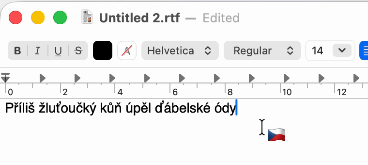
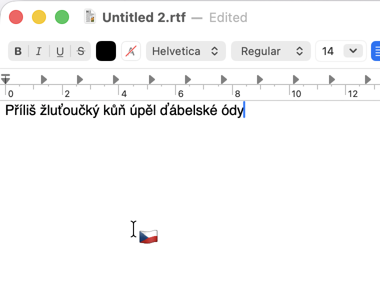
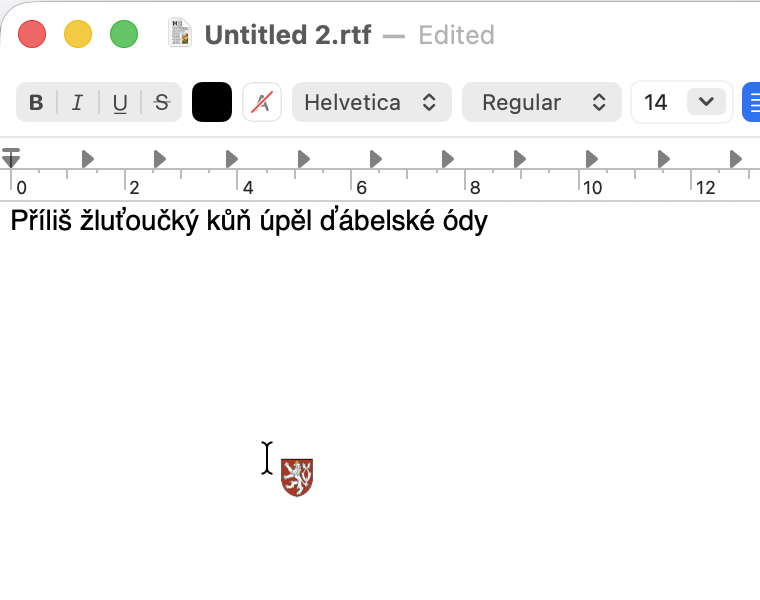
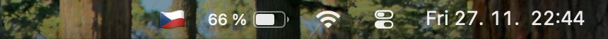
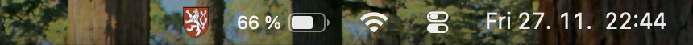

# KeyFlag

**Brings back the keyboard layout flags from classic Mac OS X.**



Older Macs showed a little country flag in the menu bar for the current keyboard layout: 🇺🇸 for U.S., 🇨🇿 for Czech, 🇬🇧 for British. Recent macOS versions replaced them with plain letter icons that are easy to miss. KeyFlag puts the flag back, drawn in that same old Mac OS X style (a small 3:2 flag with a thin edge and a soft gloss), in the menu bar and in the layout menu.

It also shows the flag next to the pointer whenever it's over a text field, so you know which language you'll type in before you start.

Prefer something else? The **Flags** menu also offers emoji flags, waving flags, coats of arms, or macOS's own icons.

| Waving | Coat of Arms |
|---|---|
|  |  |
|  |  |

> **Status:** 0.1.0, the first release. The indicator, menu, layout switching and settings work; see [TODO](#todo) for what's left.

## Install

Requires macOS 13 Ventura or later.

### Download

1. Open [Releases](https://github.com/kurtcz/KeyFlag/releases) and click `KeyFlag-<version>.zip` under Assets.
2. In Downloads, double-click the zip to unpack it.
3. Drag **KeyFlag.app** into **Applications**.
4. Open it from Applications. When macOS warns that it was downloaded from the internet, click **Open**.
5. When asked, turn on KeyFlag in **System Settings → Privacy & Security → Accessibility**. Without it, KeyFlag can't see typing or Caps Lock in other apps.

The flag then shows in the menu bar and next to the pointer. KeyFlag updates itself (Sparkle), so there's no need to reinstall for new versions.

### Homebrew

```bash
brew install --cask kurtcz/tap/keyflag
```

Then do step 5 above. Since KeyFlag updates itself, `brew upgrade` only picks up new versions with `--greedy`.

## Requirements

- macOS 13 Ventura or later
- Xcode 16+ (Swift 6) to build

## Build and run

```bash
Scripts/build-app.sh
open build/KeyFlag.app
```

On first launch macOS asks for **Accessibility** access (System Settings > Privacy & Security > Accessibility). KeyFlag needs it to tell whether the pointer is over a text field and to notice typing.

### Signing

`build-app.sh` signs with the hardened runtime and [`Resources/KeyFlag.entitlements`](Resources/KeyFlag.entitlements) (no App Sandbox: global event monitors and Accessibility queries into other apps aren't allowed in the sandbox). Unless `SIGN_IDENTITY` is set, it uses the first identity it finds in your keychain:

1. **Developer ID Application**, for distribution outside the App Store
2. **Apple Development**, for local builds
3. ad hoc (`-`)

macOS ties the Accessibility permission to the signature. With a certificate identity the permission survives rebuilds; with ad hoc signing you have to re-grant it after every build.

Put local settings (identity, bundle ID, notary profile) in `Scripts/signing.local.env`, which is gitignored. Copy [`Scripts/signing.example.env`](Scripts/signing.example.env) to start. Other options: `CONFIG=debug`, `VERSION=…`, `BUILD=…`.

### Release (notarized)

```bash
xcrun notarytool store-credentials KeyFlag --apple-id <apple-id> --team-id <team-id>
VERSION=0.2.0 Scripts/release.sh
```

This builds with a **Developer ID Application** certificate, notarizes, staples and writes `build/KeyFlag-<version>.zip`. Apple Development and Apple Distribution certificates won't do: Distribution is for App Store submissions only, and the App Store requires the sandbox.

### Updates (Sparkle)

`build-app.sh` embeds `Sparkle.framework` and writes the feed URL (`FEED_URL`, default: [`appcast.xml`](appcast.xml) on `main`) and the project's EdDSA public key (`SPARKLE_PUBLIC_KEY`) into Info.plist. The matching private key lives in the maintainer's login keychain; `release.sh` uses it through `sign_update` to sign the zip and prints the `<item>` to add to `appcast.xml`.

Back up the private key, since losing it means existing installs can't verify new updates:

```bash
.build/artifacts/sparkle/Sparkle/bin/generate_keys -x sparkle-private-key.txt
```

Keep that file somewhere safe (a password manager), not in the repo. A fork that signs its own updates creates its own pair with `generate_keys` and sets `SPARKLE_PUBLIC_KEY` and `FEED_URL`.

### Keyboard Viewer shortcut

Since macOS 12 the Keyboard Viewer is the Accessibility Keyboard, and only Apple processes may turn it on. KeyFlag runs a shortcut named **KeyFlag Keyboard Viewer** (one action: *Set Accessibility Keyboard* → On) with `shortcuts run`, which shows no UI. Apps can't add shortcuts themselves, so the first time it's missing KeyFlag offers to add it, using `Resources/KeyFlag Keyboard Viewer.shortcut` when that file is bundled. Without the shortcut, KeyFlag presses the system input menu's "Show Keyboard Viewer" item through Accessibility, which briefly opens that menu.

To refresh the bundled file: in Shortcuts, select the shortcut, choose File > Export…, pick "Anyone", and save it as `Resources/KeyFlag Keyboard Viewer.shortcut`.

## Test

```bash
swift test
```

## Layout

All logic is in the `KeyFlagCore` library so it can be tested; `Sources/KeyFlag/main.swift` only starts the app.

| File | Role |
|---|---|
| `AppDelegate.swift` | Wires the pieces together at launch |
| `Settings.swift` | Preferences in UserDefaults; posts a notification on change |
| `InputSource.swift` | Text Input Sources wrapper: current layout, list, select, change notifications |
| `InputSourceIcon.swift` | Layout icons: load, scale, tint, fallback letter badge |
| `Accessibility.swift` | Permission check/prompt and text-field detection under the pointer |
| `CursorIndicator.swift` | The click-through window that follows the pointer |
| `CursorMetrics.swift` | Where the indicator goes: beside the visible cursor, kept on screen and on the pixel grid |
| `IndicatorController.swift` | When to show it: over text input, not while typing/scrolling/dragging |
| `CaretIndicatorController.swift` | When to show the indicator at the text caret, and keeping it with the caret |
| `LayoutFlash.swift` | Large flag HUD shown when the layout switches |
| `PerAppLayout.swift` | Remembers and restores the layout for each app |
| `CapsLock.swift` | Caps Lock monitor and the ⇪ badge |
| `UnsupportedInputSource.swift` | One-time warning for input sources without a usable icon |
| `Updater.swift` | Sparkle updater |
| `Throttler.swift` | Rate-limits Accessibility queries while the mouse moves |
| `EventMonitor.swift` | Global + local NSEvent monitors |
| `StatusMenu.swift` | Menu bar item and menu |
| `SystemActions.swift` | Launch at login, Keyboard Settings, Keyboard Viewer, Emoji & Symbols |
| `FlagArt.swift`, `CoatOfArms.swift`, `WikimediaArt.swift`, `FlagMapping.swift`, `FlagAnimator.swift` | Flag drawings, the bundled Wikimedia flags and coats of arms, layout → country (and the regional/historical `SpecialFlag` list), waving animation |
| `AboutWindow.swift` | About window |

## TODO

Done:
- [x] Indicator next to the pointer over text fields, fading in and out
- [x] Hide while typing, scrolling or dragging; reappear when the pointer moves at least 8 pt (a nudged trackpad doesn't count) or the layout switches
- [x] Menu bar icon modes: layout, layout with name (there is no "hide" mode: with no icon there would be no way to reach the menu)
- [x] Switch layouts from the menu
- [x] Reduce indicator size
- [x] Tint for see-through icons (gray, red, green, blue)
- [x] Launch at login (SMAppService)
- [x] Open Keyboard Settings, Show Keyboard Viewer (silent via the bundled shortcut, else presses the input menu's item)
- [x] Show Emoji & Symbols, including the macOS 26 Tahoe fix (posts ⌃⌘Space to the frontmost app)
- [x] Flags: keyboard layouts show a country flag in the menu bar, the layout menu and next to the pointer. The **Flags** menu picks the style: Classic (drawn in code in a Mac OS X style, `FlagArt.swift`, ~90 countries, the rest fall back to emoji), Emoji, Waving (the classic flags, animated), or Off (macOS's own icons). Input methods always keep their own icons
- [x] App icon and menu bar artwork (`Scripts/make-icon.swift`)
- [x] Signing scripts (Apple Development locally, Developer ID + notarization for release)
- [x] First notarized release: 0.1.0, signed with Developer ID

- [x] Caps Lock awareness: ⇪ next to the indicator and the menu bar icon while Caps Lock is on (**Show Caps Lock State**), and the indicator reappears when it's toggled
- [x] One-time warning per input source whose icon KeyFlag can't get (it falls back to a letter badge), with a prefilled issue link to report it
- [x] Indicator placed just right of the visible cursor (its drawn pixels and hot spot, not a fixed offset), top level with the pointer; flips left/up at screen edges
- [x] Sharper icons on mixed-scale displays: pixel-aligned indicator window, waving frames carry 1× and 2× bitmaps
- [x] Automatic updates (Sparkle 2): updater and menu item, `appcast.xml`, `release.sh` signs the zip and prints the appcast item
- [x] Menu review: macOS 13+ wording, tooltips explaining each indicator option
- [x] Homebrew cask (`Casks/keyflag.rb`, for a tap)
- [x] Sparkle EdDSA key pair (public key in `build-app.sh`, private key in the maintainer's keychain)
- [x] First notarized release, 0.1.0, on GitHub Releases
- [x] Cask published in the [kurtcz/homebrew-tap](https://github.com/kurtcz/homebrew-tap) tap
- [x] **Remember Layout for Each App** (off by default): switches to the layout last used in an app when it comes to the front
- [x] **Show Indicator at Text Caret** (off by default): shows the flag beside the text caret (placed as it is next to the pointer) after a click into a text field or a layout switch, until you scroll, click or focus moves; it hides as you type when **Hide Indicator While Typing** is on and otherwise moves with the caret; only in apps that report their caret
- [x] **Flash Flag When Layout Changes** (off by default): a large flag and the layout's name in a HUD for a moment after each switch
- [x] **Flag for Each Layout**: pick any country's flag for a layout (English → 🇬🇧, Spanish → 🇲🇽), input methods included, or keep macOS's icon
- [x] **Coat of Arms** flag style: the shield from the country's coat of arms, from Wikimedia Commons, drawn a quarter taller than the flags but just as wide, so the menu bar item keeps its width (87: European countries, regions, and old kingdoms and empires such as Bohemia, Bourbon France or Prussia). To stay readable at menu bar size they leave out supporters, mantles, mottos and crowns, use the lesser arms where there are any (Czech Republic, Liechtenstein), and round state emblems are cut down to their central symbol (the Soviet hammer and sickle on the globe, Italy's star); Belarus, France, the Ottoman Empire and Austria-Hungary, whose emblems stay unreadable, show their flag. The rest fall back to the emoji flag, or the drawn flag for regional and historical flags without one
- [x] Flags with emblems or fine detail (Wales, Spain, Portugal, Mexico, the British territories, the old monarchies…) use Wikimedia Commons artwork instead of our drawings
- [x] Regional and historical flags in **Flag for Each Layout**: England, Scotland, Wales (now automatic for the Welsh layout), Northern Ireland, Cornwall, Brittany, Catalonia, Basque Country, Quebec, Kurdistan, Sápmi; old monarchies (Austrian Empire, Holy Roman Empire, kingdoms of Bavaria, France, Greece, Hanover, Hungary, Italy, Poland, Portugal, Prussia, Romania, Sardinia, Saxony, Serbia, Württemberg, Yugoslavia, plus Austria-Hungary, Bohemia, German, Ottoman, Persian and Russian empires); and other historical flags (Czechoslovakia, East Germany, Soviet Union, Yugoslavia). British territories (Isle of Man, Jersey, Guernsey, Gibraltar, Bermuda and the ensign flags) are now drawn instead of falling back to emoji

To do:

Switching
- [ ] Global shortcuts to jump to a specific layout, or toggle between the two most recent ones
- [ ] Modifier-key switching: tap left ⇧ / right ⇧ (or Caps Lock) to pick a layout
- [ ] Use a fixed layout in password fields and switch back afterwards

Indicator polish
- [ ] Settings window for indicator size, opacity, side of the pointer, how long it stays and the margin
- [ ] Exclude apps where the indicator gets in the way (games, terminals, full-screen video)
- [ ] Custom tint color from the system color picker
- [ ] Show the indicator only for some layouts (for example only when not on your main one)

Small additions
- [ ] Typing-mismatch hint: briefly highlight the flag when keystrokes look like the wrong layout (nothing stored)
- [ ] Shortcuts / AppleScript actions: "Get Current Layout", "Switch to Layout"
- [ ] Localization, starting with Czech
- [ ] Menu bar flag with a short code (🇨🇿 CS) as a compact alternative to the full name


Left out on purpose: analytics, crash reporting, and reading hardware identifiers such as the Mac's serial number.

## License

MIT. See [LICENSE](LICENSE).

The bundled flags and coats of arms in `Resources/Flags` and `Resources/CoatsOfArms` come from Wikimedia Commons and keep their own licenses (public domain, CC BY, CC BY-SA); authors and sources are in [Resources/Wikimedia-Credits.md](Resources/Wikimedia-Credits.md). `Scripts/fetch-wikimedia-art.py` downloads them again.
